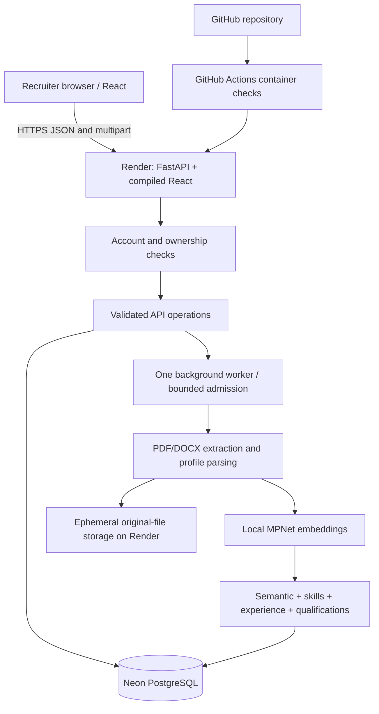
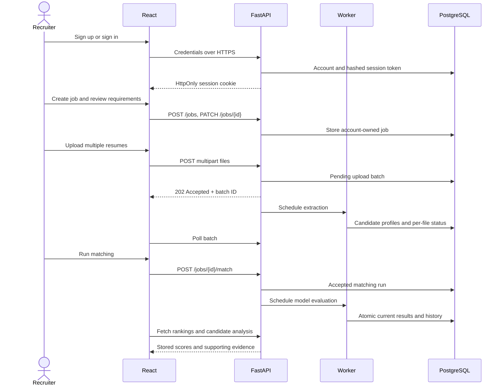
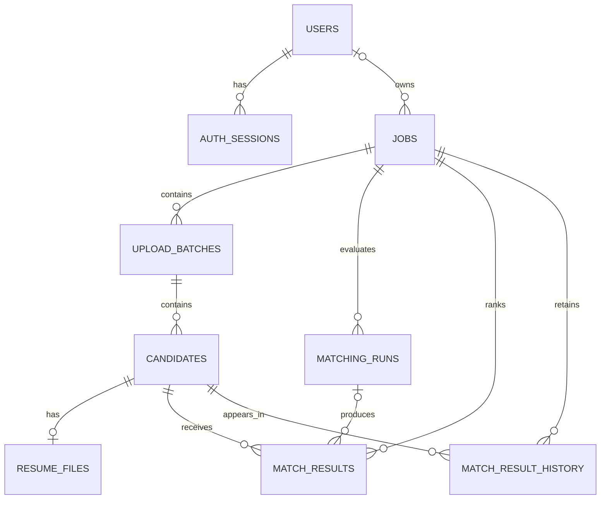

# HireLens AI — Complete Project Documentation

**AI Resume Matching and Candidate Ranking Application**

**Documentation date:** 19 November 2026

**Source baseline:** `08f2492` — recruiter accounts and populated sample workspace, with the subsequent private-copy upload flow described below

**Repository:** <https://github.com/Tejk20/AI-Resume-Checker>

**Live application:** <https://avom-resume-checker.onrender.com>

**Signup:** <https://avom-resume-checker.onrender.com/signup>

This guide explains what was built, how its code works, how scores are calculated, how data moves through the system, how to run and deploy it, and what remains limited. It describes the implemented application rather than an imagined production system. Commands assume the repository root unless a different directory is stated. No real database credentials or account passwords are included.

**21 November 2026 update:** The application is now named HireLens AI. Password recovery has been implemented with expiring email links; [sender configuration](docs/password-recovery.md) is required before live reset emails can be delivered. Older benchmark/test entries below retain their original verification baseline.

## Contents

1. [Project at a glance](#1-project-at-a-glance)
2. [Problem, objectives and scope](#2-problem-objectives-and-scope)
3. [How the project was developed](#3-how-the-project-was-developed)
4. [Technology stack and decisions](#4-technology-stack-and-decisions)
5. [System architecture](#5-system-architecture)
6. [Repository and file guide](#6-repository-and-file-guide)
7. [Application pages and recruiter workflow](#7-application-pages-and-recruiter-workflow)
8. [Signup, login and account isolation](#8-signup-login-and-account-isolation)
9. [Job description extraction](#9-job-description-extraction)
10. [Document upload and validation](#10-document-upload-and-validation)
11. [Resume information extraction](#11-resume-information-extraction)
12. [Skill taxonomy and evidence](#12-skill-taxonomy-and-evidence)
13. [Semantic matching with MPNet](#13-semantic-matching-with-mpnet)
14. [Complete scoring methodology](#14-complete-scoring-methodology)
15. [Ranking, analysis and score history](#15-ranking-analysis-and-score-history)
16. [Database design](#16-database-design)
17. [Background processing and recovery](#17-background-processing-and-recovery)
18. [API reference](#18-api-reference)
19. [Frontend implementation](#19-frontend-implementation)
20. [Configuration reference](#20-configuration-reference)
21. [Local installation on Windows](#21-local-installation-on-windows)
22. [Docker and Codespaces](#22-docker-and-codespaces)
23. [Live deployment through GitHub, Render and Neon](#23-live-deployment-through-github-render-and-neon)
24. [Memory optimization and ONNX deployment](#24-memory-optimization-and-onnx-deployment)
25. [Synthetic demo data](#25-synthetic-demo-data)
26. [Testing and observed verification](#26-testing-and-observed-verification)
27. [Security, privacy and responsible use](#27-security-privacy-and-responsible-use)
28. [Troubleshooting](#28-troubleshooting)
29. [Maintenance, extension and operations](#29-maintenance-extension-and-operations)
30. [Limitations and future improvements](#30-limitations-and-future-improvements)
31. [Demonstration and interview explanation](#31-demonstration-and-interview-explanation)
32. [Glossary and reference material](#32-glossary-and-reference-material)

---

## 1. Project at a glance

Avom Resume Intelligence is a web application for comparing a batch of candidate resumes against a job description. A recruiter creates a job, reviews extracted requirements, uploads PDF/DOCX resumes, starts matching and inspects ranked candidates with supporting evidence.

The application combines semantic similarity with explicit skills, relevant professional experience and qualification checks. It uses a pretrained sentence embedding model; it does not train a new language model or use a conversational chatbot to invent scores.

| Item | Implemented choice |
|---|---|
| Frontend | React, Vite, JavaScript/JSX, Tailwind and custom CSS |
| Backend | Python, FastAPI, Uvicorn |
| Database | PostgreSQL, accessed through SQLAlchemy and psycopg |
| Schema migrations | Alembic |
| Semantic model | `sentence-transformers/all-mpnet-base-v2` |
| Normal local model runtime | Sentence Transformers / PyTorch on CPU |
| Live Render runtime | Official quantized MPNet ONNX export / ONNX Runtime on CPU |
| PDF / Word parsing | PyMuPDF / python-docx |
| Sentence processing | spaCy English pipeline or blank-English sentencizer fallback |
| Authentication | Email/password accounts and database-backed browser sessions |
| Deployment | GitHub source → Render Docker service → Neon PostgreSQL |
| Sample workspace | Three roles; 12 fictional resumes evaluated under each role |
| Main score | `0.25S + 0.40K + 0.25E + 0.10Q` |

Public visitors can explore read-only fictional candidates. Signed-in recruiters can create private jobs and process their own candidate pool. The score is an estimated alignment with the stated job, not a probability of hiring success.

## 2. Problem, objectives and scope

### The problem

Reading many resumes manually is slow, and a keyword-only comparison misses similarities in meaning. A resume can describe relevant API development without repeating the exact wording of a job description. Conversely, a high textual similarity cannot establish that a mandatory skill or qualification has actually been demonstrated.

### Objectives

- Accept pasted or uploaded job descriptions.
- Extract and let recruiters correct skills, experience and qualifications.
- Process at least ten resumes in one batch; the implemented batch limit is 50.
- Support selectable-text PDF and DOCX documents.
- Produce an explainable score between 0 and 100.
- Rank candidates and show matched skills, missing evidence and relevant experience.
- Preserve results and their model/scoring provenance in a database.
- Offer real signup/login and private recruiter-owned jobs.
- Provide an accessible fictional sample workspace for demonstration.

### Scope boundaries

The system supports evidence-based review. It does not automatically reject candidates, verify employment with employers, validate certificates with issuing authorities, perform OCR, or establish legal compliance or fairness through an audit. It is a working demonstration with account controls, not a complete enterprise applicant tracking system.

## 3. How the project was developed

The implementation evolved in several stages:

| Stage | Work completed | Reason |
|---|---|---|
| Core application | React screens, FastAPI routes, PostgreSQL entities, PDF/DOCX parsing and candidate ranking | Deliver a complete resume-to-ranking workflow |
| Scoring policy | Adopted semantic 25%, skills 40%, experience 25%, qualifications 10% | Give explicit skills the largest contribution while retaining semantic and experience evidence |
| Model upgrade | Made MPNet the default and retained MiniLM as an explicit baseline | Evaluate a stronger sentence representation without hiding historical model changes |
| Explainability | Added section-aware evidence, scoring configuration, matching runs and archived results | Make the score inspectable and preserve earlier evaluations |
| Job picker | Added arbitrary custom titles and grouped AI/ML naming variants | Avoid a fixed role list and duplicate-looking AI options |
| Container preparation | Built React and Python into one same-origin Docker application | Simplify hosting and prevent deployed browsers from calling their own localhost |
| Codespaces demonstration | Added Docker/PostgreSQL setup and port forwarding | Run the complete system in a temporary GitHub development environment |
| External hosting | Connected the GitHub repository to Render and Neon | Provide a normal public application URL beyond a running Codespace |
| Smaller model runtime | Added official 8-bit ONNX MPNet inference without PyTorch in the Render image | Fit the application into the free host's 512 MiB memory limit |
| Accounts and sample content | Added signup/login/logout, ownership checks and idempotent real-scored fictional data | Make the dashboard useful on first visit and protect recruiter-owned work |

Selected source milestones:

- `2f360cc`: application and explainable MPNet ranking source.
- `4cd86dd`: container and GitHub Codespaces preparation.
- `c069291`: corrected Codespaces image/user configuration.
- `a5f1ac2`: Render deployment and quantized MPNet memory checks.
- `08f2492`: recruiter accounts and populated read-only sample workspace.

The About page intentionally explains application capabilities. The detailed algorithm belongs in this documentation and the candidate evidence view, rather than a technical methodology landing page.

## 4. Technology stack and decisions

### Frontend

| Library/tool | Purpose |
|---|---|
| React | Components, state, effects and conditional UI |
| React Router | Client-side navigation, account pages and protected write pages |
| Vite | Development server and optimized production bundles |
| Axios | Central API client, JSON requests and multipart upload progress |
| Tailwind / PostCSS / Autoprefixer | CSS tooling alongside the custom stylesheet |
| Recharts | Compatibility distribution chart |
| Lucide React | Interface icons |
| React Hot Toast | Upload, matching and form feedback |
| Vitest, Testing Library, jsdom | Component and interaction tests |

The interface uses JavaScript/JSX. It is not a TypeScript application. Dependency ranges are declared in `frontend/package.json`; resolved frontend packages are recorded in `frontend/package-lock.json`. Docker uses `npm ci` for that lockfile.

### Backend and AI

| Library/tool | Purpose |
|---|---|
| FastAPI | API endpoints, dependency injection and generated OpenAPI documentation |
| Pydantic / pydantic-settings | Input validation, output contracts and environment settings |
| Uvicorn | ASGI application server |
| SQLAlchemy | Database models, sessions and parameterized query expressions |
| psycopg | PostgreSQL driver |
| Alembic | Ordered, versioned database migrations |
| python-multipart | Multipart upload parsing |
| PyMuPDF | Text extraction from PDFs |
| python-docx | DOCX paragraphs and table text |
| spaCy | Sentence boundaries; optional installed English pipeline |
| Sentence Transformers / PyTorch | Normal CPU embedding runtime |
| NumPy | Vectors, normalization, dot products and aggregation |
| ONNX Runtime / tokenizers | Smaller production MPNet inference and tokenization |
| huggingface-hub | Downloading model assets during image build |
| pytest / httpx | Backend and real HTTP workflow verification |
| Python standard library | Password derivation, random session tokens, hashing, worker threads and utilities |

`backend/requirements.txt` is the normal development/PyTorch dependency set. `backend/requirements-render.txt` is the smaller hosting set: it omits PyTorch and Sentence Transformers and adds ONNX Runtime/tokenizers. Python dependencies use version ranges, not a complete reproducible lockfile; future dependency updates must be retested.

### Why PostgreSQL?

The data has clear relationships: jobs own batches, batches contain candidates, and results refer to both jobs and candidates. PostgreSQL supplies relational constraints and JSONB for flexible extracted evidence. A separate vector database is not used: this application compares each selected job with its candidate pool using NumPy and process-local embeddings.

## 5. System architecture

The backend is a **modular monolith**: one application process contains routing, account handling, extraction, matching and a bounded background worker. It is not a microservice deployment.



### A typical request sequence



The deployed frontend and API share one origin. The browser calls `/api/v1`; it does not connect directly to Neon and does not receive database credentials.

## 6. Repository and file guide

```text
AI-Resume-Checker/
├── PROJECT_DOCUMENTATION.md       This complete guide
├── README.md                      Quick setup and project introduction
├── Dockerfile                     Normal CPU/PyTorch full-stack image
├── Dockerfile.render              Smaller CPU/ONNX hosting image
├── docker-compose.yml             Local PostgreSQL
├── compose.hosted.yml             Full application + private PostgreSQL
├── compose.render-test.yml        512 MiB application test override
├── render.yaml                    GitHub-connected Render Blueprint
├── .devcontainer/                 Codespaces configuration
├── .github/workflows/             Container integration checks
├── backend/
│   ├── requirements.txt
│   ├── requirements-render.txt
│   ├── .env.example
│   ├── alembic.ini
│   ├── alembic/versions/           Four schema migrations
│   ├── app/
│   │   ├── main.py                App, middleware, startup and health
│   │   ├── api/                   Domain and authentication routes
│   │   ├── core/                  Settings and database session factory
│   │   ├── models/                SQLAlchemy entities
│   │   ├── schemas/               API contracts
│   │   ├── data/skill_taxonomy.json
│   │   └── services/              Extraction, scoring, auth and workers
│   └── tests/                     Six backend test modules
├── frontend/
│   ├── package.json / package-lock.json
│   ├── vite.config.js
│   └── src/
│       ├── main.jsx               Browser router and root render
│       ├── App.jsx                Workspace layout and page routes
│       ├── styles.css             Theme, layouts and responsive styling
│       ├── services/api.js        Axios client and API error messages
│       ├── hooks/useLoad.js       Loading/error/retry request lifecycle
│       ├── components/            Shared UI, auth and searchable job picker
│       └── pages/                 Dashboard, jobs, uploads, ranking, auth
├── sample_data/                   Fictional resumes and example JDs
├── scripts/                       Setup, verification and model utilities
└── docs/                          Focused supporting documentation
```

### Backend implementation map

| File | Responsibility |
|---|---|
| `app/main.py` | FastAPI instance, lifespan, optional demo seeding, CORS, generic error handling, database health and frontend mounting |
| `app/core/config.py` | Environment settings, default weights, model choice and validation |
| `app/core/database.py` | SQLAlchemy base, engine, `SessionLocal` and request database dependency |
| `app/models/entities.py` | Ten application tables and their constraints/relationships |
| `app/models/__init__.py` | Entity exports and migration discovery |
| `app/schemas/contracts.py` | Validated job input, extracted profile output and paginated API responses |
| `app/api/routes.py` | Jobs, files, candidates, dashboard, matching, ranking and history APIs |
| `app/api/auth_routes.py` | Signup, login, current session and logout |
| `services/documents.py` | File structure validation and text extraction |
| `services/extraction.py` | JD parsing, section detection, candidate fields and employment dates |
| `services/skills.py` | Canonical skill/alias extraction and related-skill evidence |
| `services/privacy.py` | Explicit demographic/contact filtering before scoring |
| `services/semantic.py` | Token windows, model loading, normalized vector cache and evidence retrieval |
| `services/onnx_embeddings.py` | Tokenizer adapter, small CPU inference session and sentence pooling |
| `services/scoring.py` | Skills, relevant experience, qualifications, weighted score and explanation |
| `services/history.py` | Deep-copied snapshots before result replacement/invalidation |
| `services/workers.py` | Single worker, admission semaphore, per-file processing, atomic matching and interruption recovery |
| `services/demo.py` | Deterministic fictional sample jobs and real scored results |
| `services/auth.py` | Password hashes, sessions, origin checks, throttling and visible-job predicates |
| `services/frontend.py` | Compiled assets and SPA routes without swallowing API 404s |

### Frontend implementation map

| File | Responsibility |
|---|---|
| `App.jsx` | Sidebar, topbar, profile, page routing, selected job and job refresh |
| `components/AuthContext.jsx` | Current user, session discovery, logout and account-required route wrapper |
| `components/UI.jsx` | Reusable headings, loading/error states, status chips, skill chips and score display |
| `components/JobPicker.jsx` | Searchable roles, keyboard selection, custom titles and saved-description selection |
| `components/jobOptions.js` | Suggested roles, AI/ML title normalization and grouping |
| `pages/Auth.jsx` | Signup/signin forms, password visibility and confirmation |
| `pages/Dashboard.jsx` | Counts, recent jobs, score distribution, activity and sample-data notice |
| `pages/CreateJob.jsx` | Pasted/uploaded JD and correction of extracted requirements |
| `pages/UploadResumes.jsx` | Drag/drop, file selection, progress, batch polling and matching |
| `pages/Rankings.jsx` | Search, score filter, relevant-experience sorting, pagination and analysis links |
| `pages/Analysis.jsx` | Candidate profile, component contributions, evidence, uncertainty and history |
| `pages/Methodology.jsx` | About the application; the filename remains from the earlier page |

### Script guide

| Script | Purpose and important behavior |
|---|---|
| `generate_samples.py` | Regenerates the fictional PDFs, DOCXs and JDs; replaces sample files, so do not run merely to read the examples |
| `download_model.py` | Downloads/loads the configured Sentence Transformer and checks an embedding |
| `download_onnx_model.py` | Downloads pinned official quantized MPNet assets and checks the weight checksum |
| `start-backend.ps1` | Changes to backend, applies migrations, starts local Uvicorn |
| `start-frontend.ps1` | Starts the local Vite server |
| `start_hosted.py` | Applies migrations, then starts one hosted Uvicorn process |
| `codespaces-start.sh` | Builds/starts the Compose stack, checks HTTP and prints forwarded URL |
| `check_hosted_http.py` | Checks database/API health, React routes and API 404 boundaries |
| `verify_workflow.py` | Creates a synthetic QA account and three private jobs, uploads 12 resumes per job, performs real matching and checks public/private boundaries; it writes data to its configured API |
| `verify_mpnet_upgrade.py` | Uses a separate PostgreSQL verification database to check MiniLM/MPNet rematching, history and process restart persistence; intended for local compatibility mode |
| `compare_models.py` | Runs fresh model subprocesses and records comparison reports on fictional data |
| `verify_saved_results.py` | Checks previously saved rankings and scoring evidence against stored expectations |
| `rematch_saved_jobs.py` | Re-evaluates saved jobs; changes stored results and archives previous versions |
| `recalculate_scores.py` | Weight-only recalculation; does not regenerate semantic embeddings |
| `check_database.py` | Local database connectivity/schema inspection utility |
| `local_postgres.py` | Optional isolated Windows PostgreSQL compatibility helper |
| `recover_postgres_tools.py` | Compatibility tool recovery for the portable local database setup |

Some maintenance scripts predate mandatory hosted login and assume the local development environment. They are not all production administrative APIs. Read a script's source and target before executing a data-changing utility.

## 7. Application pages and recruiter workflow

### Overview — `/`

Displays active job descriptions, processed resume records, candidate evaluations, mean compatibility, recent jobs, upload activity and a four-band score distribution. The bands are 0–39, 40–59, 60–79 and 80–100.

For visitors, only sample jobs appear in the hosted application. For signed-in recruiters, the totals include their own jobs plus public sample jobs. These are job/candidate evaluation counts, not globally deduplicated people.

### Signup and signin — `/signup`, `/login`

Signup collects full name, email, password and confirmation. Login uses email/password. Successful signup signs the account in immediately. Logout revokes the current server-side session. The browser does not store an authentication token in local storage.

### Create/review job — `/jobs/new`

1. Enter any title.
2. Paste a JD or upload a supported file.
3. Extract requirements; this creates a saved job.
4. Review required/preferred skills, minimum experience, qualifications and responsibilities.
5. Save corrections and continue to upload.

`?title=...` prefills a custom title; `?edit=<job-id>` reviews an existing job. Sample requirements are read-only. Editing a real job's requirements archives and invalidates its previous current results, because those scores no longer describe the revised JD.

### Upload resumes — `/upload`

Choose a job, select/drop up to 50 PDFs/DOCXs, upload and wait for parsing. For a sample job, **Upload to my own copy** first creates a private copy of its reviewed requirements and uploads the selected files there. It does not copy the sample candidates or change the public job. Existing private jobs upload directly. Individual failures appear without discarding successful documents. Run matching once readable candidate records exist; the page explains when processing still blocks that action. Sample jobs themselves remain protected from uploads/rematching, with an active link to their existing sample rankings.

### Candidate ranking — `/rankings`

Choose a saved job, search by candidate name, set a minimum score, sort by score or relevant years, and open candidate analysis. The normal page size is 20, with API support for up to 100.

### Candidate analysis — `/jobs/:jobId/candidates/:candidateId`

Shows extracted candidate information, overall score, each component's score and weight, contribution in points, explicit and missing skills, relevant employment, qualification evidence, semantic requirement/passage pairs, warnings and available earlier evaluations.

### About — `/methodology`

Explains application features and use. It is not the authoritative location for the scoring formula; this guide and `docs/matching-algorithm.md` provide that detail.

### Active job behavior

The role suggestions are optional. Any custom job title can be saved. Common `AI`, `ML`, `AI Engineer`, `ML Engineer`, `AI/ML Engineer`, and corresponding artificial-intelligence/machine-learning names normalize to the displayed group **AI/ML Engineer** when they match the implemented alias rule. This is an interface grouping, not a database merge. Original IDs, descriptions, candidates and results stay separate; a saved-description selector appears when one group has multiple JDs.

## 8. Signup, login and account isolation

### Account creation

The API validates a trimmed name of 2–100 characters, an email string up to 254 characters with a basic address-format check, and a password of 10–128 characters. The email is trimmed and lowercased. It must be unique in the database. Password confirmation is a frontend check; the server receives one password.

The backend stores a password derivation, never the plaintext password:

```text
pbkdf2_sha256$600000$<random-salt-hex>$<derived-key-hex>
```

PBKDF2-HMAC-SHA256 uses 600,000 iterations and a random 16-byte salt. Verification uses a constant-time digest comparison. Unknown login emails still take the password-hashing path. Two password computations can run concurrently; excess requests receive a retryable busy response.

### Sessions

After login/signup, the server generates a random URL-safe token from 32 random bytes. Only its SHA-256 digest is stored in `auth_sessions`. The browser receives the raw token as the `avom_session` cookie.

| Cookie/session property | Behavior |
|---|---|
| HttpOnly | Browser JavaScript cannot read the cookie through `document.cookie` |
| Secure | Enabled on hosted HTTPS; disabled for local HTTP compatibility |
| SameSite | `lax` |
| Path | `/` |
| Duration | Seven days; fixed expiry, not a sliding refresh policy |
| Server-side revocation | Logout deletes the token-hash row |
| Persistent session storage | PostgreSQL, so normal app restart does not itself erase sessions |

The application uses opaque database sessions, not JWTs or third-party OAuth login. Expired sessions do not authenticate requests. Expired rows are cleaned when creating a session; there is no dedicated scheduled cleanup task.

### Authorization

Jobs contain an `owner_id`. Batches and candidates are scoped through their job. Results, run history and dashboard queries apply the same visible-job rules. A recruiter cannot view another recruiter's private job, candidate, batch, ranking or history just by guessing a UUID; those accesses return 404.

Sample jobs have `is_demo=true`, are readable publicly, and cannot be patched, uploaded into or rematched through normal APIs, including by signed-in users.

`AUTH_REQUIRED=true` requires an account for job creation and other writes. The Render image and Blueprint enable it. Local compatibility mode defaults to false, allowing ownerless local work; it is not the hosted security configuration. Pre-account ownerless non-demo rows are preserved in the database but hidden in hosted account mode. Signup does not silently claim earlier records.

### Origin checks and throttling

Write requests with an `Origin` header must match the request origin, configured public origin, Render's external URL, or configured allowed frontend origins. CLI clients without an Origin header remain supported. Session cookie policy and origin checks reduce cross-site risk; this is not a claim of a full independent security audit.

The single-process account service keeps a 15-minute attempt window, with limits of 60 attempts per source IP and ten per normalized-email hash. It returns 429 and `Retry-After: 900` when limited. Counters reset on restart and are not a distributed rate limiter. Reverse-proxy IP behavior should be reviewed before increasing real-world traffic.

Forgotten-password recovery uses a hashed, 30-minute single-use token delivered through a configured email provider. The token is carried in a URL fragment rather than an HTTP query string, and a successful reset revokes all account sessions. Email delivery is unavailable until a verified sender and provider key are configured. Email verification, MFA, account deletion and administrator/team roles are not implemented. See [recovery setup and security details](docs/password-recovery.md).

## 9. Job description extraction

`parse_job()` first removes explicit sensitive/contact scoring text, then examines lines and sentence/clause boundaries.

- Required/must/essential/minimum wording identifies required context.
- Preferred/nice-to-have/bonus/optional/desirable wording identifies preferred context.
- A short heading can establish context for subsequent clauses.
- Taxonomy matches populate canonical required and preferred skills.
- If a skill appears in both, required wins.
- Experience uses a numeric-years pattern near the word “experience.”
- Degree/bachelor/master/certification-related sentences become qualifications.
- Build/develop/design/maintain/implement/deploy/train and related action wording contributes responsibilities.

The result includes extraction warnings and is intended for recruiter correction. The parser does not infer every possible skill or understand all negative and mixed clauses. The job title is not automatically generated from the JD; it is supplied in the input form.

## 10. Document upload and validation

### Accepted formats and limits

| Rule | Implemented behavior |
|---|---|
| Batch size | 1–50 resumes, default maximum 50 |
| Per-file size | Default 10 MiB (`MAX_FILE_MB`) |
| Formats | `.pdf`, `.docx` |
| PDF signature | Must begin with `%PDF-` |
| PDF encryption | Password-protected PDFs rejected |
| PDF length | Maximum 100 pages |
| DOCX structure | Valid ZIP with `word/document.xml` |
| DOCX expansion | Sum of expanded entries no more than 40 MiB |
| Extracted text | At least 20 non-blank characters and no more than 200,000 characters |
| Scanned images | No OCR; an explicit extraction error is returned |

The API reads up to the configured size limit plus one byte per file to detect oversized uploads. Extension checks happen before staging; detailed file validation occurs during processing. The worker rejects duplicate SHA-256 file hashes already processed under the same job. A duplicate across different jobs is permitted, since each JD has a distinct candidate pool and evaluation.

PDF extraction uses `page.get_text(sort=True)` through PyMuPDF. DOCX extraction includes paragraphs and table rows through python-docx. Complex visual reading order can still be imperfect.

Original filenames are sanitized to basenames. Staged originals use UUID filenames in the upload directory. No application route serves that directory publicly. These checks do not constitute antivirus scanning or a strong sandbox for malicious parser input.

## 11. Resume information extraction

The parser recognizes sections such as Summary/Profile, Skills/Technical Skills, Work/Professional Experience/Employment, Education/Qualifications, Projects, Certifications and Internships. Recognized aliases map to a common internal section name.

| Extracted information | Method |
|---|---|
| Name | Conservative first-header-line pattern, 2–4 words; certain resume/title words rejected |
| Email | Regex match |
| Phone | Limited formatted-phone regex |
| Skills | Canonical taxonomy and aliases on sanitized scoring text |
| Employment | Date-range patterns within experience sections |
| Title/company | Role heading split around `|` or `at` where recognizable |
| Education/projects/certifications | Detected section lines |
| Total professional experience | Union of non-internship employment date intervals |
| Parsing uncertainty | Explicit warning strings |

The parser is conservative and English-oriented. Unrecognized information is left unknown, rather than invented. A missing name or date can produce a review warning. Phone and name patterns do not cover every country, writing system or resume layout.

### Employment dates

Supported patterns include month-name/year, numeric month/year, year-only values, hyphen/en-dash/em-dash or “to” ranges, and Present/Current/Now.

```text
month_index = year × 12 + month - 1
years = merged_month_count / 12
```

Intervals are end-exclusive: January 2020 to January 2023 means three years. Overlaps are merged so simultaneous jobs are not added twice. Year-only dates use January and receive uncertainty warnings. Reversed, unrecognized, pre-1950 or future-ending ranges are excluded. Internship roles do not contribute professional years. Projects are evidence but do not add professional employment time.

## 12. Skill taxonomy and evidence

`backend/app/data/skill_taxonomy.json` defines canonical names, aliases and related technologies. For example, an alias can map Postgres to PostgreSQL or ReactJS to React.

The extractor uses phrase boundaries and longest-overlap selection:

- Java is not found merely because JavaScript appears.
- React Native takes precedence over its overlapping shorter React phrase.
- The short `JS` alias needs supporting software/web context.
- Matches record the actual phrase and whether it was exact or an alias.

Related technologies are displayed as transferable evidence. They earn no exact required-skill credit. Mentioning Django does not satisfy an explicit FastAPI requirement.

Recruiters can enter unfamiliar skills manually in a JD, but automatic resume extraction still requires a matching taxonomy entry. To add supported aliases, edit the JSON and add regression cases for boundary/overlap behavior.

## 13. Semantic matching with MPNet

### What embeddings do

A sentence embedding represents text as a vector. Semantically similar passages tend to have more aligned vectors. This lets the system compare meaning even when the wording differs.

The default model is `sentence-transformers/all-mpnet-base-v2`, with 768-dimensional embeddings and an active maximum input length of 384 tokens including special tokens. The selectable MiniLM baseline has 384 dimensions and a 256-token limit. The model is pretrained; this project does not fine-tune it or claim a measured hiring-accuracy improvement.

### Text preparation

Before scoring, explicit demographic lines and known candidate identifiers are filtered from evidence. Text is separated into detected sections, then into sentences and tokenizer-bounded windows. Actual special-token overhead is reserved and windows overlap by up to 32 tokens. Long-document tails are covered rather than discarded by an arbitrary chunk-count limit.

### Requirement groups

The semantic component has its own internal weights; they are separate from the final 25/40/25/10 formula.

| Job group | Internal weight | Preferred resume sections |
|---|---:|---|
| Responsibilities | 0.50 | Experience, projects, summary |
| Skill context | 0.20 | Skills, experience, projects, summary |
| Qualifications | 0.15 | Education, certifications |
| Role title context | 0.15 | Summary, experience, projects |

Missing groups are omitted and the remaining group weights normalized. When the preferred sections are unavailable, the system searches available passages and marks a section fallback for review. Fully unstructured resumes use a sanitized unstructured fallback.

### Similarity and aggregation

Vectors are L2-normalized. Their dot product is cosine similarity:

```text
cosine(a, b) = dot(a, b) / (norm(a) × norm(b))
```

For every JD passage, select the highest eligible resume-passage similarity after clamping it to 0–1. Average those maxima inside each requirement group. Take the normalized weighted group mean and multiply by 100. The semantic component is rounded to two decimals.

Example group means of 0.80, 0.70, 0.90 and 0.60 give:

```text
S = 100 × (0.50×0.80 + 0.20×0.70 + 0.15×0.90 + 0.15×0.60)
  = 76.50
```

Stored evidence contains the JD passage, resume passage, both section labels, similarity and fallback flag. Repetition does not earn additive points. High semantic similarity alone never proves a mandatory skill, certificate or employment duration.

### Caching and performance

One process-cached model is loaded for the active identifier/backend/cache configuration. A model lock prevents concurrent initialization/encoding. Job vectors are reused for every candidate. Uncached passages are deduplicated and prepared together; the hosting runtime still processes one passage at a time to bound transient memory.

The LRU vector cache uses SHA-256 text keys and a byte/entry bound. Its namespace includes model ID, revision, token limit, pipeline version, cache folder and model instance. Changing the namespace clears incompatible embeddings. Prepared candidate vectors are rejected if used with a different evaluation namespace.

The default vector-cache budget is 128 MiB; Render uses 4 MiB. The cache is in memory and disappears on restart. Stored match results persist in PostgreSQL.

## 14. Complete scoring methodology

### Final formula

```text
Match Score = 0.25S + 0.40K + 0.25E + 0.10Q
```

| Symbol | Meaning | Default weight |
|---|---|---:|
| S | Semantic similarity | 25% |
| K | Explicit required/preferred skill coverage | 40% |
| E | Relevant professional experience | 25% |
| Q | Qualifications, represented internally as the education component | 10% |

Components use a 0–100 scale. The persisted algorithm identifier is `2.0.0-section-aware`.

### K: skill coverage

```text
R = identified required skills / required skills
P = identified preferred skills / preferred skills

K = 100 × (0.80R + 0.20P)       when both sets exist
K = 100 × coverage             when only one set exists
K = not applicable            when neither set exists
```

For four of five required skills and one of two preferred skills:

```text
K = 100 × (0.80×4/5 + 0.20×1/2) = 74
```

“Not identified” describes the evidence found in the resume, not a verified absence of the candidate's ability.

### E: relevant experience

A professional role is relevant when its role-description skills cover at least one third of the JD required skills; preferred skills are used if required skills are absent. When the JD has no skills, distinctive title-word overlap is used. Related roles' date intervals are merged.

```text
E = 100 × min(1, relevant_years / required_years)
```

Three relevant years against a four-year requirement gives 75. More experience does not push this component above 100. Unknown candidate employment evidence receives a flagged provisional 50, not invented years. If the JD has no positive experience requirement, E is not applicable.

Total professional years and JD-relevant professional years are distinct. The ranking's experience sort uses relevant years. An unrelated Java role does not become Python experience merely because Python appears elsewhere on the resume.

### Q: qualifications

Without a qualification requirement, Q is not applicable. Otherwise requirements are checked and averaged:

| Value | Interpretation |
|---:|---|
| 100 | Stated degree level met/exceeded with the limited subject check, or an explicit equivalent-experience clause satisfied |
| 50 | Unknown, unverified certification or potentially equivalent evidence; review required |
| 0 | Explicitly identified degree level below the stated requirement |

Recognized levels are diploma/secondary, bachelor, master and doctorate. Subject matching broadly recognizes computer science, engineering and information technology. Certifications are not automatically confirmed by loose keyword overlap. These rules are limited heuristics, not academic credential verification.

### Missing JD requirements and normalized weights

If a component is not required by the job, remove its weight and renormalize the remaining ones:

```text
effective_weight[k] = default_weight[k] / sum(applicable default weights)
contribution[k] = component[k] × effective_weight[k]
overall = round(clamp(sum(contributions), 0, 100), 2)
```

Unknown candidate evidence is different from an absent job requirement. Unknown evidence stays applicable with its provisional policy; its weight is not silently redistributed.

### Worked example

| Component | Score | Weight | Contribution |
|---|---:|---:|---:|
| Semantic | 80 | 0.25 | 20.00 |
| Skills | 90 | 0.40 | 36.00 |
| Experience | 75 | 0.25 | 18.75 |
| Qualifications | 100 | 0.10 | 10.00 |
| **Total** | | **1.00** | **84.75 / 100** |

If experience and qualifications are absent from the JD, the semantic and skill effective weights become `0.25/0.65` and `0.40/0.65`. Scores of 80 and 90 then produce **86.15**.

The server rejects invalid weight dictionaries: the four internal keys must be exactly `semantic`, `skill`, `experience`, `education`; values must be finite, nonnegative, no greater than one and sum to one. At least one applicable weight must be positive.

Full-precision contributions are stored. The overall score is rounded once at the final aggregation, while the semantic component was already rounded during semantic aggregation. Display formatting can create tiny differences from manually adding rounded visible numbers.

## 15. Ranking, analysis and score history

The current result table has a unique `(job_id, candidate_id)` constraint. Rematching updates that pair instead of creating multiple current rows.

Default sorting is descending overall score, with candidate UUID as a stable tie-breaker. Experience sorting uses the `relevant_years` value stored in explanation JSON, places unknown years last, and retains score ordering for ties. Name search is case-insensitive and escapes SQL wildcard characters.

Each matching run records model identity, scoring settings, algorithm version, candidate count, status, timestamps and safe error text. Current results reference the run and include model/scoring provenance.

Before replacing a result, the previous scores, explanation, evaluation timestamp, model and scoring configuration are deep-copied into history in the same transaction. Editing JD requirements also archives and removes obsolete current results. A failed rematch rolls back new results and preserves the previous current set, while recording a failed run.

Changing the model setting alone does not relabel old results. Explicit rematching is required to produce new embeddings and scores. A weight-only recalculation reuses and labels the existing semantic result; it cannot be presented as new-model inference.

## 16. Database design

There are ten application tables, plus Alembic's version-tracking table. Application entities share a UUID primary key and creation timestamp. PostgreSQL stores flexible lists/dictionaries in JSONB; isolated SQLite tests use the JSON variant.



### Table reference

| Table | Main fields and purpose |
|---|---|
| `users` | `name`, unique/indexed normalized `email`, `password_hash` |
| `auth_sessions` | `user_id`, unique/indexed `token_hash`, indexed `expires_at`; user FK has cascade-on-delete |
| `password_reset_tokens` | `user_id`, unique/indexed token digest, expiry and consumption timestamps; never stores the raw email-link token |
| `jobs` | Nullable indexed `owner_id`, `is_demo`, title, raw JD, required/preferred skills, minimum experience, qualifications, responsibilities, extraction warnings, update timestamp, match status/error |
| `upload_batches` | Indexed `job_id`, status, total/processed/failed counts, per-file errors, completion timestamp |
| `candidates` | Indexed `batch_id`, name, email, phone, skills/evidence, total professional years, detailed roles, education, projects, certifications, raw extracted text and warnings |
| `resume_files` | Unique `candidate_id`, sanitized original filename, private path, MIME type, indexed SHA-256 hash, extraction status/error |
| `matching_runs` | Indexed `job_id`, embedding model, scoring configuration, algorithm version, processing/completed/failed status, candidate count, completion timestamp/error |
| `match_results` | Indexed job/candidate IDs, overall/component scores, matched/missing lists, explanation JSON, algorithm/model/configuration, optional run ID |
| `match_result_history` | Job/candidate IDs, previous result UUID, optional run ID, model/configuration and a payload snapshot |

Nullable score components mean “not applicable,” not zero. Unknown candidate evidence can still produce a provisional numeric component and a warning.

### Constraints and indexes

- Unique normalized user emails and session-token digests.
- Unique resume-file record per candidate.
- Unique current job/candidate result pair.
- Overall score check: 0 through 100.
- Upload and matching-run status check constraints.
- Foreign keys between related records.
- Indexes on common job, candidate, batch, expiry and score lookup fields.

### Migrations

| Revision | Change |
|---|---|
| `ac6625edd2a0` | Initial jobs, batches, candidates, file metadata and current results |
| `b31e0a2f7d42` | Matching runs, provenance fields and result history |
| `d28f9e2b603a` | Users, sessions, job ownership and sample-job flag |
| `e42bc30891d7` | Single-use password-reset token storage |

Startup runs `alembic upgrade head` before hosted Uvicorn starts. The application does not create production tables through `Base.metadata.create_all()`. Migrations preserve existing rows; migration commands still deserve database backups and review when handling valuable data. Database downgrades can remove added tables/columns and are not a routine rollback method.

## 17. Background processing and recovery

`ThreadPoolExecutor(max_workers=1)` performs document processing and model matching. A five-slot bounded semaphore limits admitted user operations, including active work. Account hashing uses a separate two-slot bound.

### Upload states

```text
pending → processing → completed
                     → partially_completed
                     → failed
```

Each file is committed independently. Successful extraction creates a candidate and file metadata; failures update batch counts/errors. `processed_files + failed_files` is the finished count. A bad file does not fabricate a candidate or erase successful records.

### Matching states

```text
idle → processing → completed
                  → failed
```

The route stores an accepted run before queuing work. The worker loads the model, prepares embeddings and computes all new results in a transaction. Success commits the new current result set and history. Failure keeps previous current results and records a safe failure state.

On startup, unfinished uploads become partial/failed with a restart warning; unfinished matching runs become failed. The in-memory queue is not restored. Retry the affected upload or matching action after recovery. Graceful shutdown waits for worker work to drain.

This design requires one API process. It does not provide database-transaction locking against every simultaneous conflicting request, a durable distributed queue or reliable multi-worker coordination. Do not increase Uvicorn workers without redesigning those parts.

## 18. API reference

**Production base:** `https://avom-resume-checker.onrender.com/api/v1`

**Local base:** `http://127.0.0.1:8000/api/v1`

**OpenAPI UI:** `/docs`

**OpenAPI JSON:** `/openapi.json`

JSON names use snake_case; IDs are UUIDs. Paginated resources return `{ "items": [...], "total": n }`. Session cookies authenticate account requests.

| Method | Path after `/api/v1` | Purpose / access |
|---|---|---|
| GET | `/health` | Public database connectivity and configured model; 200 or 503 |
| POST | `/auth/signup` | `{name,email,password}`; 201, user summary and session cookie |
| POST | `/auth/login` | `{email,password}`; user summary and session cookie |
| GET | `/auth/me` | User summary or null, plus `auth_required` |
| POST | `/auth/logout` | Revoke current session and clear cookie; 204 |
| POST | `/auth/forgot-password` | Request a conditional recovery email; 202, or 503 when delivery is unconfigured |
| POST | `/auth/reset-password` | Redeem a valid single-use token, change password and revoke sessions |
| GET | `/dashboard` | Counts/distribution/activity for visible jobs, sample counts and loading state |
| POST | `/jobs` | Create account-owned job from `{title,raw_text}`; 201 |
| POST | `/jobs/upload` | Multipart `title` and `file`; 201 |
| GET | `/jobs` | Visible jobs; private jobs before sample jobs, then newest first |
| GET | `/jobs/{job_id}` | Visible job details and matching status |
| POST | `/jobs/{job_id}/copy` | Copy visible job requirements into a new private job; 201; no candidates or results copied |
| PATCH | `/jobs/{job_id}` | Correct private job requirements; archive/invalidate old results |
| POST | `/jobs/{job_id}/resumes` | Multipart repeated `files`; private writable job; 202 |
| GET | `/batches/{batch_id}` | Visible-job batch progress and errors |
| GET | `/jobs/{job_id}/candidates` | Candidate summaries for a visible job |
| GET | `/candidates/{candidate_id}` | Authorized detailed extracted profile and original filename |
| POST | `/jobs/{job_id}/match` | Start private-job matching; 202 with `job_id`, `run_id`, `status` |
| GET | `/jobs/{job_id}/rankings` | Filtered/sorted stored results |
| GET | `/jobs/{job_id}/matches/{candidate_id}` | Score, evidence and provenance |
| GET | `/jobs/{job_id}/runs` | Prior run status/model/configuration |
| GET | `/jobs/{job_id}/matches/{candidate_id}/history` | Earlier result snapshots |

### Common validation

- Job title: 2–200 characters; JD text: 30–100,000 characters.
- Requirement list: at most 100 entries, each at most 2,000 characters.
- Lists are trimmed/deduplicated; an empty list removes requirements; null lists are invalid.
- Required and preferred skills must be disjoint.
- Minimum experience: zero to 60, or null when no requirement is stated.
- Job/candidate list limits: normally 50, maximum 100; nonnegative offset.
- Rankings: normal limit 20; `search` at most 100 characters; `min_score` 0–100; `sort=score` or `experience`.
- History: normal limit 20; matching runs: normal limit 50; both maximum 100.

### Example job request

```json
{
  "title": "Python Backend Developer",
  "raw_text": "Python Backend Developer with at least 3 years of experience. Required Python, FastAPI, PostgreSQL, REST APIs and Docker. AWS preferred. Build reliable backend services. Bachelor degree in Computer Science or equivalent experience."
}
```

### Example requirement update

```json
{
  "required_skills": ["Python", "FastAPI", "PostgreSQL"],
  "preferred_skills": ["Docker"],
  "min_experience": 3,
  "qualifications": ["Bachelor degree in Computer Science or equivalent experience"],
  "responsibilities": ["Build and maintain reliable backend APIs"]
}
```

### HTTP statuses

| Status | Meaning |
|---:|---|
| 200 | Successful read/update/login |
| 201 | Account or job created |
| 202 | Upload or matching accepted; poll until completed |
| 204 | Logout completed |
| 401 | Login required or incorrect credentials |
| 403 | Sample job is read-only, or write origin rejected |
| 404 | Resource absent or not visible to this account |
| 409 | Account email already exists or job currently busy |
| 422 | Input/document validation, invalid options or no readable candidates |
| 429 | Account attempt limit |
| 503 | Queue/hash admission full or database unhealthy |
| 500 | Generic internal failure; inspect protected server logs |

Client errors normally use `detail`; validation can return a list. Internal tracebacks, file paths and credentials are not included in generic error responses. There is no original-resume download endpoint and no general-purpose account/job deletion API.

## 19. Frontend implementation

`main.jsx` installs the browser router and toast container. `App.jsx` owns the workspace layout, active job and shared job list. `AuthProvider` fetches `/auth/me` and supplies the current account; `RequireAccount` redirects visitors from write pages to signin when the hosted API requires authentication.

`api.js` chooses `VITE_API_URL` when configured. Development otherwise targets local port 8000; production defaults to relative `/api/v1`. `withCredentials: true` allows cookie sessions, and the standard timeout is 60 seconds. Long matching work returns 202 and is polled; it is not held inside one long browser request.

`useLoad()` implements loading/error/retry state and ignores late responses after unmount. Upload and matching pages poll their own operation state. Job options refresh on navigation/window focus. The selected job ID is stored as `avom-job` in local storage, but session tokens and passwords are not. Selection is reset when the account changes.

The UI includes responsive sidebar behavior, drag/drop upload selection, accessible labels, keyboard job selection, inline errors and disabled actions while processing. The signup page has a responsive brand/story panel and a form with password visibility and confirmation. The stylesheet uses DM Sans/Manrope with fallbacks and a green/neutral palette.

Vite splits React and chart code into separate production chunks. FastAPI serves those assets and returns the SPA index for application routes. Unknown `/api/...` endpoints remain JSON 404s rather than returning the frontend, and path traversal/out-of-root file requests are rejected.

## 20. Configuration reference

`Settings` reads environment variables and a `.env` in the backend process's current directory. Unknown `.env` keys are ignored. Restart the process after changing runtime settings; existing scores need explicit rematching if their inputs/model/weights changed.

| Variable | Normal default | Hosted Render choice / purpose |
|---|---|---|
| `DATABASE_URL` | Local PostgreSQL, loopback port 5433 | Secret Neon URL with SSL parameters |
| `CORS_ORIGINS` | Localhost and 127.0.0.1 on 5173 | `[]`, because UI/API share an origin |
| `UPLOAD_DIR` | `storage/uploads` relative to backend | `/app/storage/uploads` |
| `MAX_FILE_MB` | 10 | Per-file size limit |
| `MAX_BATCH_FILES` | 50 | Batch admission limit; normal UI/API wording assumes 50 |
| `EMBEDDING_MODEL` | `sentence-transformers/all-mpnet-base-v2` | Same MPNet model family |
| `MODEL_NAME` | Older compatible alias | `EMBEDDING_MODEL` takes precedence |
| `EMBEDDING_BACKEND` | `pytorch` | `onnx-int8` |
| `ONNX_MODEL_DIR` | `../.model-cache/onnx-mpnet` | `/app/.model-cache/onnx-mpnet` |
| `EMBEDDING_CACHE_MB` | 128 | 4; valid range 0–2048 |
| `EMBEDDING_BATCH_SIZE` | 32 | 1; valid range 1–128 |
| `MODEL_CACHE` | `../.model-cache` | Disk model cache for the normal runtime |
| `SCORING_WEIGHTS` | JSON 0.25/0.40/0.25/0.10 | Validated four-component policy |
| `FRONTEND_DIST` | Unset | `/app/frontend/dist`; enables compiled UI serving |
| `AUTH_REQUIRED` | false | true |
| `SECURE_COOKIES` | false | true for HTTPS |
| `PUBLIC_ORIGIN` | Empty | The actual public application origin |
| `SEED_DEMO_DATA` | false | true |
| `PORT` | Hosted start script defaults to 8000 | Runtime server bind port |
| `VITE_API_URL` | Frontend `.env` local API URL | `/api/v1` at container frontend build time |
| `HF_HUB_OFFLINE` | Not required initially | 1 after image-build model download |
| `HF_HUB_DISABLE_XET` | Runtime/download option | 1 in image download environment |
| `TOKENIZERS_PARALLELISM` | Runtime option | false |
| `OMP_NUM_THREADS`, `MKL_NUM_THREADS` | Runtime thread hints | 1 in small hosting image |
| `PYTHONDONTWRITEBYTECODE` | Python option | 1 in images |
| `PYTHONUNBUFFERED` | Python option | 1 for prompt container logs |
| `PIP_NO_CACHE_DIR` | Build option | 1 to reduce image installation cache |

Plain `postgres://` and `postgresql://` URLs are normalized to SQLAlchemy's `postgresql+psycopg://` driver form. SSL query parameters are retained. Do not remove `sslmode=require` or copy a shell `psql` command into `DATABASE_URL`.

Example non-secret scoring value:

```dotenv
SCORING_WEIGHTS={"semantic":0.25,"skill":0.40,"experience":0.25,"education":0.10}
```

The Render build needs `requirements-render.txt`; the normal requirements do not install ONNX Runtime. If selecting `onnx-int8` locally, install the hosting dependencies or explicitly install its additional runtime dependencies and download its assets first.

## 21. Local installation on Windows

### Requirements

Use Python 3.11 or 3.12, a supported Node LTS release compatible with the repository tooling (the container uses Node 22), Git, and Docker/PostgreSQL. Internet is needed for dependency/model downloads. The normal PyTorch model requires more memory than the hosting ONNX variant. Allow several GB for dependencies and model files.

### Clone and install

```powershell
git clone https://github.com/Tejk20/AI-Resume-Checker.git
cd AI-Resume-Checker
python -m venv .venv
.\.venv\Scripts\python.exe -m pip install -r backend/requirements.txt
Copy-Item backend/.env.example backend/.env
Copy-Item frontend/.env.example frontend/.env
```

Do not overwrite your existing `.env` files if you have already configured the project.

### Start PostgreSQL

```powershell
docker compose up -d db
```

This exposes only `127.0.0.1:5433`, mapping to PostgreSQL's internal 5432. The supplied local demo database/user is `resume_matcher` / `resume`, with the local example password in `.env.example`. These are development defaults, not the Neon deployment secret.

If Docker is unavailable, the existing compatibility helper is:

```powershell
.\.venv\Scripts\python.exe scripts/local_postgres.py start
```

It uses an isolated ignored storage directory and PostgreSQL 16.4 with loopback trust for fictional local evaluation. It is an older compatibility setup, not the recommended production database or a reason to reuse another project's database files.

### Download model

```powershell
.\.venv\Scripts\python.exe scripts/download_model.py
```

Optional English spaCy pipeline:

```powershell
.\.venv\Scripts\python.exe -m spacy download en_core_web_sm
```

Without that optional pipeline, the code uses `spacy.blank('en')` and its sentencizer. Skills, sections, dates and qualification rules remain deterministic.

### Run backend — terminal 1

```powershell
cd backend
..\.venv\Scripts\python.exe -m alembic upgrade head
..\.venv\Scripts\python.exe -m uvicorn app.main:app --host 127.0.0.1 --port 8000
```

### Run frontend — terminal 2, from repository root

```powershell
cd frontend
npm.cmd ci
npm.cmd run dev
```

Open `http://127.0.0.1:5173`. The backend health endpoint is `http://127.0.0.1:8000/api/v1/health`; interactive API documentation is `http://127.0.0.1:8000/docs`.

For local account enforcement and sample data, add the following to `backend/.env`, then restart the backend:

```dotenv
AUTH_REQUIRED=true
SECURE_COOKIES=false
PUBLIC_ORIGIN=http://127.0.0.1:5173
SEED_DEMO_DATA=true
```

Use the same hostname consistently for frontend/API during local cookie testing. Keep Secure cookies disabled for plain local HTTP. Stop Uvicorn/Vite with Ctrl+C; the portable database can be stopped with `python scripts/local_postgres.py stop` using the project interpreter.

## 22. Docker and Codespaces

### Normal complete Docker stack

```bash
docker compose -f compose.hosted.yml up -d --build --wait
```

This builds the normal PyTorch image and starts an isolated PostgreSQL container. The app is on port 8000; the hosted database is not published externally. Named volumes store database data and uploads for that stack. The Compose password is a local demo value, not a public deployment credential.

### Smaller constrained-host test stack

```bash
docker compose -f compose.hosted.yml -f compose.render-test.yml up -d --build --wait --wait-timeout 180
```

The override selects `Dockerfile.render`, limits the app to 512 MiB, disables swap, enables required accounts and demo seeding, and disables Secure cookies for its local HTTP tests. It is a verification setup, not the actual Neon deployment.

### Build/start sequence

1. Node stage installs frontend lockfile dependencies and compiles React.
2. Python stage installs the selected backend dependency set.
3. Source/scripts/sample files and compiled frontend are copied.
4. Required model assets are downloaded during the build.
5. A non-root app user and upload directory are created.
6. Runtime starts offline for model downloads.
7. `start_hosted.py` applies migrations, then starts one Uvicorn worker.
8. Lifespan recovers interrupted operations and optionally schedules demo seeding.

### Codespaces

The development container uses `mcr.microsoft.com/devcontainers/base:ubuntu-24.04`, Docker-in-Docker and the image's `vscode` user, requesting a two-core/8-GB environment. Port 8000 is forwarded. Creation runs the build/start script; later starts run its start/check step.

Inside the browser Codespace terminal:

```bash
bash scripts/codespaces-start.sh --build
```

That command belongs in the Linux Codespace, not Windows PowerShell. Codespaces are temporary development/demo environments with timeouts and usage allowances. The forwarded port is private until explicitly changed. They are not the permanent external hosting method used for the live link.

## 23. Live deployment through GitHub, Render and Neon

### Hosting responsibilities

| Service | Responsibility |
|---|---|
| GitHub | Source code, version history and Actions checks |
| Render | Builds/runs Docker, serves React/FastAPI, public HTTPS URL |
| Neon | Persistent PostgreSQL application records and sessions |

GitHub Pages cannot run this Python/PostgreSQL application by itself. GitHub remains the deployment source; external hosting runs the server.

### Render Blueprint

`render.yaml` defines a Docker web service named `avom-resume-checker`, branch `main`, plan `free`, Dockerfile `./Dockerfile.render`, health path `/api/v1/health`, and automatic deployment after checks pass. `DATABASE_URL` uses `sync: false`, so its secret value is supplied in the provider dashboard and not stored in Git.

The existing setup uses the public application origin, required accounts, Secure cookies and automatic sample seeding. If deploying under a different URL, update the public-origin setting accordingly.

### Repeatable deployment procedure

1. Create/sign into Neon on the Free plan and create a dedicated PostgreSQL project/database.
2. In Connect, copy the actual PostgreSQL connection string, including SSL parameters. Use the copy control, not the displayed masked password or a `psql` wrapper command.
3. Sign into Render and connect only `Tejk20/AI-Resume-Checker` if GitHub access is requested. This project does not require Snatcho-Labs organization access.
4. Create a Blueprint from the repository, using branch `main`, path `render.yaml`, and a Blueprint name such as `avom-resume-checker`.
5. Paste the Neon URL directly into the provider's `DATABASE_URL` secret field.
6. Confirm the compute plan remains Free; deploy the Blueprint.
7. Wait until the web service is Live, then use the actual URL displayed by Render.
8. Check health, accounts, sample counts, candidate analysis and a private workflow.

For this deployment, the actual confirmed URL is `https://avom-resume-checker.onrender.com`.

### GitHub Actions

| Workflow | Validation |
|---|---|
| `Hosted container checks` (`container.yml`) | Normal PyTorch image, PostgreSQL, compiled routes and real synthetic HTTP matching |
| `Free host memory checks` (`render-check.yml`) | ONNX image with app memory capped at 512 MiB and no swap; genuine account/private matching plus public sample data; no PyTorch dependency, OOM kill or restart |

Both workflows have read-only repository permissions, run on standard Ubuntu runners, and have 25-minute job timeouts. They run for their configured source paths and can be manually dispatched. Test database containers are separate from Neon; Actions does not copy the real database or create paid hosting resources.

The account workflow creates three private test jobs with 36 evaluations. In the seeded memory-check stack it also verifies three public sample jobs with 36 evaluations, so that isolated test can contain 72 evaluation records split across visibility scopes. The public live dashboard still has 36 sample evaluations, not 72 public records.

### Persistence and service limits

Neon retains database rows across ordinary Render restarts within the chosen provider plan and quotas. Render's free filesystem is ephemeral: uploaded original files disappear on restart/redeploy/sleep. The saved extracted candidate text and evaluations stay in PostgreSQL, and rematching uses those records. Original-file retention requires external object storage and an implemented access/retention design.

The free web service sleeps after inactivity and wakes on requests, delaying the first visit. It is a public hosted demonstration, not a guarantee of always-on availability or a service-level agreement. Provider pricing, eligibility and quotas change; consult the linked official documentation before creating new resources or altering plans.

## 24. Memory optimization and ONNX deployment

The normal measured PyTorch MPNet process exceeded the small free host's memory budget. The project therefore retains the normal runtime for local/larger environments and adds a separate ONNX hosting runtime. It does not silently downgrade to MiniLM.

### What changed

- Use the official quantized MPNet Transformer export, around 110 MB on disk.
- Avoid installing/importing PyTorch and Sentence Transformers in the Render image.
- Load the tokenizer directly through the `tokenizers` package.
- Use ONNX Runtime CPU execution, one inter/intra-operation thread, basic graph optimization, and disabled memory arena/pattern/prepacking options.
- Process one passage at a time and keep only a 4 MiB retained embedding cache.
- Apply mean pooling and L2 normalization explicitly to produce 768-dimensional sentence vectors.

The export produces token embeddings, not already pooled sentence vectors. The adapter does not pad its one-passage input; its attention mask is all ones, so averaging valid token embeddings is the mask-aware mean in this execution path. It supplies only input names the ONNX graph actually expects.

### Pinned model provenance

```text
Model:     sentence-transformers/all-mpnet-base-v2
Revision:  e8c3b32edf5434bc2275fc9bab85f82640a19130
Weights:   onnx/model_quint8_avx2.onnx
SHA-256:   aa5c27172d77bbd1cbae3628cbac4b26d7c12adabff25d2d4285d0f29159b237
```

The downloader verifies the weight checksum and writes a local manifest. Runtime metadata records the backend (`onnx-int8`), precision (`int8`), revision, dimensions and pipeline settings. Requesting the MiniLM model while selecting the MPNet-only ONNX backend fails explicitly.

Quantization approximates the original model. Scores and evidence selection can differ slightly from float32 PyTorch; the mathematical weighting policy and explicit skills/experience/qualification rules remain the same. Passing a workflow and memory cap does not establish recruitment accuracy or equivalence on all possible resumes.

The earlier ONNX container check observed approximately 283.9 MiB of app memory after its workflow. That is a point-in-time container statistic, not a measured worst-case peak. The stronger fact is that both the earlier workflow and the updated account/sample workflow completed under an enforced 512 MiB/no-swap cap without an OOM kill or container restart. Very long documents, high concurrency and different libraries can change memory demand.

## 25. Synthetic demo data

The committed fixtures include six PDFs and six DOCXs, three text JDs and three PDF JDs. All candidate identities, employers and contacts are fictional; contacts use `example.test`.

| Candidate | Fictional background |
|---|---|
| Alex Rowan | Python/FastAPI/PostgreSQL backend development |
| Morgan Vale | Python backend development with aliases such as Python3/Postgres |
| Casey Brook | Python/Django/MySQL backend experience |
| Riley Fern | React/JavaScript/Node/TypeScript full stack |
| Jordan Pine | React/Node full stack |
| Taylor Ash | Earlier-career frontend profile |
| Avery Reed | PyTorch, scikit-learn, NLP and sentence embeddings |
| Quinn Lake | Data science and NLP |
| Cameron Moss | TensorFlow-oriented ML |
| Drew Elm | Java/Spring Boot, deliberately different from the sample target stacks |
| Skyler Wren | Design-oriented profile with limited technical overlap |
| Finley Grey | Incomplete employment/qualification evidence |

Roles are Python Backend Developer, React Full Stack Developer and AI/ML Engineer. The same 12 fictional people are evaluated against all three roles. There are 36 job-specific candidate records/evaluations, not 36 unique fictional people. Different-role and incomplete profiles are included intentionally so score differences and uncertainty can be demonstrated.

### Seeding implementation

`services/demo.py` uses a fixed UUID namespace and deterministic UUID5 job IDs. For each missing sample job it reads the committed JD, extracts all 12 resumes through the real parser, stores a completed upload batch and candidate/file metadata, and invokes the existing real matching worker. Scores are not prefilled constants.

Already evaluated sample jobs are skipped on subsequent starts, preventing routine redeploy duplicates. Failed initialization is logged and can be retried at a later startup. The dashboard refreshes while sample initialization is pending. Seeding does not overwrite recruiter-owned jobs or assign old data to new accounts.

The live anonymous dashboard was verified with three jobs, 36 resumes and 36 results. Its observed average was **32.92**, with many deliberately unrelated profile/job comparisons. That value is measured, not a target to inflate. A different model/configuration or regenerated data can change it.

## 26. Testing and observed verification

### Local automated checks on 19 November 2026

| Check | Observed result |
|---|---|
| Full backend suite | 49 passed, two optional model tests skipped |
| Affected API/auth/model-serving tests | 20 passed, two optional model tests skipped |
| Latest upload/copy API regression | Nine passed, including source protection and cross-account access |
| Frontend suite after the upload-flow fix | 15 passed across six files |
| Production frontend build | Passed |
| Python source parsing | Passed for the inspected application/migration/workflow files |
| Patch whitespace checks | Passed before publication |

The skipped tests are opt-in local real MPNet/MiniLM tests, not failures. Real model inference was separately exercised by both GitHub container workflows.

### Backend test modules

| Module | Coverage |
|---|---|
| `test_extraction.py` | Candidate/JD extraction, dates, aliases, uncertainty and demographic handling |
| `test_scoring.py` | Weight policy, applicable components, relevant experience and qualification behavior |
| `test_semantic.py` | Model loading, chunk coverage, caching, normalized vectors, section evidence and explicit failures |
| `test_hosted.py` | SPA routes, assets, traversal/API 404 boundaries and database-URL normalization |
| `test_onnx_embeddings.py` | Pooling/normalization, bounded inference input and unsupported-model failure |
| `test_api.py` | Migration-backed CRUD/uploads, rematch/history/failure, auth sessions, account isolation and idempotent sample seed |

Document extraction tests are included in `test_extraction.py`. API fixtures apply the committed Alembic migrations to isolated SQLite databases rather than assuming that model definitions alone prove the schema works.

### Account tests

Verified signup validation and normalized duplicate email behavior; password hashing rather than plaintext storage; HttpOnly cookie; login/logout and expiry; rejection of anonymous hosted writes; isolation of jobs, candidates, batches, rankings, runs, history and totals; immutable samples; cross-site origin rejection; and duplicate-free seeding.

### Real container workflow results

- [Free host memory checks — account/sample update](https://github.com/Tejk20/AI-Resume-Checker/actions/runs/44551396602): passed.
- [Hosted PyTorch container checks — account/sample update](https://github.com/Tejk20/AI-Resume-Checker/actions/runs/44551396549): passed.
- [Earlier ONNX memory check](https://github.com/Tejk20/AI-Resume-Checker/actions/runs/44538971258): passed.

The real workflow uses HTTP job creation, mixed PDF/DOCX uploads, genuine embeddings, bounded/sorted scores, reconciled contributions and durable reads through a fresh authenticated client. The seeded test additionally checks public samples and private-job invisibility to visitors.

### Live deployment verification

Observed on the deployed service:

- Frontend HTTP 200 and PostgreSQL health connected.
- Hosted authentication required.
- Three completed sample roles with 12 ranked candidates each.
- Sample result provenance identifies the ONNX backend.
- Successful synthetic QA signup, Secure/HttpOnly/SameSite cookie, authenticated session, logout, login again and logout.
- `/signup` serves the current compiled frontend and its account-page JavaScript.

One clearly synthetic QA account was created for this live check; no recruiter jobs were modified. Interactive browser-driven visual QA was not available. Component interaction tests, built assets and live HTTP verification are different checks and should not be described as screenshot/viewport verification.

### Run tests yourself

```powershell
# From backend, with the project's virtual environment installed:
..\.venv\Scripts\python.exe -m pytest -q

# Opt in only when both model assets and resources are available:
$env:RUN_MODEL_TESTS='1'
$env:HF_HUB_OFFLINE='1'
..\.venv\Scripts\python.exe -m pytest -q

# From frontend:
npm.cmd test
npm.cmd run build
```

`verify_workflow.py` targets local port 8000 and writes synthetic records; use it against an isolated verification stack. The model-upgrade verifier creates a separate PostgreSQL database and needs database-creation permission. Historical test counts/scores in older documentation are dated evidence, not the current suite total.

## 27. Security, privacy and responsible use

### Implemented controls

- PBKDF2 password derivation and random per-account salts.
- Random expiring session tokens, hashed token storage, HttpOnly/Secure/SameSite cookies and logout revocation.
- Owner-based authorization on direct and nested data access.
- Public sample jobs kept read-only.
- Origin checks for write requests and credentialed configured CORS.
- Basic bounded account attempt counters and hash concurrency.
- File extension, signature/structure, expanded size, page and extracted-text limits.
- UUID internal upload filenames and no public upload static route.
- Candidate summary lists omit contact details; raw extracted resume text is not returned by the normal candidate detail contract.
- SQLAlchemy query expressions rather than string-built SQL for request values.
- Generic internal errors and logs that avoid printing candidate content/passwords.
- Scoring text filters explicit sensitive demographic lines, contacts and known identities.
- `.gitignore`/`.dockerignore` exclude credentials, uploads, model caches, local databases and verification artifacts.

### What these controls do not establish

There is no independent penetration test, malware sandbox, production fairness audit, legal/privacy certification, comprehensive identity redaction, retention/deletion workflow or enterprise tenant administration. The schema stores extracted candidate text and contact data; ordinary JSONB storage is not application-level field encryption. TLS and provider security do not substitute for access/retention design.

Use fictional data for the public demonstration. Do not put database URLs, passwords, session cookies, real resumes or private model caches in Git commits, screenshots or documentation examples.

Scores should support human review. Explicitly missing evidence and uncertain qualifications should be reviewed rather than treated as proof of inability. Related technology, semantic similarity and years inferred from a document are not verified proficiency or employment facts.

## 28. Troubleshooting

| Symptom | Likely cause / next action |
|---|---|
| Live site is slow on the first visit | Free service waking; wait and retry; inspect Render events if it never becomes healthy |
| Dashboard is initially empty during a new deployment | Sample seed still running; current UI refreshes while pending; inspect backend logs if it remains incomplete |
| Signup page still looks old | Hard-refresh with Ctrl+Shift+R and confirm the latest commit is Live |
| API returns HTML instead of JSON | Wrong URL/base path or an old deployment; use `/api/v1/...` and inspect status/content type |
| 401 on create/upload/match | Sign in and confirm the session cookie is sent |
| Signin does not persist locally | Secure cookie on HTTP, inconsistent localhost/127.0.0.1 hosts, or CORS/cookie mismatch |
| 403 when editing a sample | Expected read-only sample; create a private job |
| Upload/match buttons seem disabled on a sample | Select a CV and use **Upload to my own copy**; the app creates a private job and enables matching when parsing finishes. Older cached pages need a hard refresh. |
| 403 origin error | Public-origin/CORS configuration does not match the browser URL |
| 404 for a known private candidate | Current account does not own its job, session expired, or selected ID belongs to a different account |
| 409 processing conflict | Wait for that job's upload/match to finish |
| 429 on accounts | Wait for the attempt window; review proxy IP behavior and logs |
| 503 admission full | Worker/hash bound reached; retry later rather than launching more processes |
| Database unavailable | Check secret URL, credentials, SSL parameters and Neon availability; do not print the URL in logs |
| Incorrect Neon password after copying | Use the Copy control for the actual connection string, not masked asterisks |
| File rejected | Check type, size, page limit, encryption, readable text and corruption |
| Duplicate resume error | Same file hash already exists under this job |
| Experience is unknown | Dates/sections were not recognized or professional evidence is missing |
| Custom skill never matches | Add its canonical name/aliases to the taxonomy and retest extraction |
| Match failed after restart | Queue is in memory; rerun matching after recovery |
| Old scores remain after a model switch | Expected until explicit rematching; inspect saved model/run provenance |
| Hosted app runs out of memory | Verify `Dockerfile.render` and `onnx-int8`, not the full PyTorch image; inspect logs and input size/concurrency |
| Original PDF missing after sleep/redeploy | Render's ephemeral storage; extracted PostgreSQL records can still be used |
| No OCR/text extraction | Scanned/image-only documents are unsupported; provide text-bearing PDF/DOCX |
| `bash` reports missing WSL in Windows | Run Codespaces commands in the browser's Linux terminal; local Windows uses PowerShell setup |
| Codespace recovery says missing `codespace` user | Pull the current configuration and rebuild the container using the standard base image/`vscode` user |
| Codespace is stuck at a plain setup page | Check browser Console; DNS failures for `assets.github.dev` prevent editor scripts from loading |
| Vite/pytest cannot create temp files | Local permission/sandbox problem; run with appropriate workspace/temp access, not by changing application logic |

Health only confirms the database connection and configured model name. It does not run an embedding. A real synthetic match is needed to verify model initialization and inference.

## 29. Maintenance, extension and operations

### Normal code change

1. Make a focused change and inspect its diff.
2. Run relevant backend/frontend tests and production build when needed.
3. Add migrations for database changes; do not manually edit production schemas without a controlled plan.
4. Commit to the intended repository and push the configured branch.
5. Inspect GitHub Actions and Render deployment status.
6. Verify live health and the changed feature with fictional data.

### Adding a skill

Add its canonical entry, aliases and deliberately chosen related technologies to the taxonomy JSON. Test phrase boundaries, overlapping names and misleading substrings. Rematch affected candidate pools after confirming extraction is correct. Existing parsed candidate skills are stored records; changing the taxonomy alone does not retroactively reparse every saved resume.

### Changing the model or formula

Update validated settings and restart. Keep a meaningful new algorithm/version policy for semantic/scoring changes. Download the correct model assets. Compare on the same fictional inputs, inspect model/backend/revision metadata and preserve history. Do not equate larger embeddings with proven better hiring outcomes.

### Database and backups

Neon is persistent storage, but persistence is not a documented backup/recovery guarantee. Configure appropriate backups/exports and retention before valuable data is introduced. Never run `docker compose down -v`, drop a database or downgrade account migrations as an ordinary troubleshooting step; those operations can remove data. Local named volumes and cloud PostgreSQL are separate stores.

### Logs and model assets

Inspect Render build/runtime logs for migrations, model loading, demo initialization and safe exception types. Keep logs free of credentials and applicant content. Models are downloaded during build and packaged for offline runtime; update pinned ONNX revision/checksum deliberately and rerun memory/inference checks.

### Dependency updates

Review npm lockfile changes and Python range resolution, run the real workflows, and monitor memory. A build using updated dependencies can behave differently even when application code did not change. The constrained workflow is a regression check, not a substitute for reviewing supply-chain and vulnerability findings.

### Safe scaling path

Before adding API instances/workers, introduce durable task storage, transactional job/run locking, shared object storage, distributed throttling, and a clear model-serving/concurrency strategy. Multiple independent in-memory executors cannot safely coordinate this application's current job state just by sharing PostgreSQL.

## 30. Limitations and future improvements

| Area | Current limitation | Possible next step |
|---|---|---|
| OCR | Scanned resumes rejected | Dedicated OCR stage with validation and cost controls |
| Extraction | English patterns and limited layouts | Reviewed field corrections, broader parsers and multilingual evaluation |
| Experience | Heuristic dates/relevance | Recruiter correction and richer role-skill evidence |
| Qualifications | Limited levels/subjects; certificates unverified | Structured qualification mapping and verification process |
| Model evaluation | Synthetic, label-free comparisons | Recruiter-labeled relevance benchmark and ranking metrics |
| Calibration/fairness | No probability calibration or audited fairness result | Representative consented data and independent assessment |
| Accounts | No verified email, reset, MFA or account deletion | Complete account lifecycle and audit trail |
| Original files | Ephemeral on free Render | Private object storage and retention/deletion controls |
| Background tasks | In-memory single-process queue | Durable queue, worker leases and reliable retry/idempotency |
| Concurrency | State guards are not complete cross-process locking | Transactional locks and concurrent-request regression tests |
| Operations | Free service sleeps and quotas apply | Appropriate capacity/SLA when requirements justify it |
| Abuse prevention | Process-local throttling | Shared rate limiter, validated client IPs and stronger ingress controls |
| Production data | Demonstration safeguards only | Privacy/retention policy, security review, backups and hardened uploads |

These are future improvements, not features to claim in a demo or interview as already implemented.

## 31. Demonstration and interview explanation

### A short project explanation

> Avom Resume Intelligence is a React and FastAPI application that compares PDF and Word resumes against a job description. PostgreSQL stores extracted profiles, matching runs and explainable scores. MPNet sentence embeddings find semantic alignment, while explicit skills, relevant employment and qualification rules keep the score grounded in stated evidence. The score uses 25% semantic similarity, 40% skills, 25% relevant experience and 10% qualifications, with normalization when a job omits a component. The live app is built from GitHub on Render and uses Neon PostgreSQL; a quantized ONNX MPNet runtime fits the small host. Recruiters have private accounts, and visitors can explore real-scored fictional examples.

### Suggested live demonstration

1. Open the overview and identify the clearly labeled sample workspace.
2. Select the Python sample role and open its rankings.
3. Open a strong candidate and show skills, relevant years and semantic evidence.
4. Compare the same fictional profile under a different job; explain why the score changes.
5. Show an incomplete profile and explain provisional evidence warnings.
6. Sign up/sign in, create a private job and review its extracted requirements.
7. Upload the supplied 12 sample resumes and start matching.
8. Show progress, filtering and candidate-level explanations.
9. Correct a requirement and explain archival/invalidation before rematching.
10. Sign out and show that private jobs are absent while public samples remain.

### Common questions

**Is this just keyword matching?** No. Explicit skill coverage is one component; MPNet independently compares section-specific sentence meaning. Neither replaces the other.

**Did you train MPNet?** No. The application uses pretrained model assets and implements extraction, evidence retrieval, caching, aggregation and web workflows around them.

**Is 90% a 90% chance of success?** No. It is a heuristic job-alignment score under the configured policy.

**Why not use only embeddings?** Similar wording cannot establish explicit mandatory skills, verified certificates or dated professional experience.

**Why ONNX on the live host?** The original PyTorch runtime exceeded the small host's memory budget. The official quantized MPNet export was tested under a hard 512 MiB cap while preserving the model family and scoring policy.

**Why can two runtimes give slightly different scores?** Quantization approximates the original model; similarity and best evidence may change slightly. Provenance records the backend and precision.

**How do users remain separated?** Job ownership is enforced in backend queries and nested resource checks, not merely by hiding UI links. Public sample jobs are explicitly marked and read-only.

**What survives restart?** Accounts, sessions, extracted text, jobs and results remain in PostgreSQL; process caches/queues do not. Original files on free Render storage are ephemeral.

**Can this reject candidates automatically?** The implemented flow provides rankings and evidence for human review; it has no automatic rejection decision.

## 32. Glossary and reference material

| Term | Meaning here |
|---|---|
| JD | Job description |
| Embedding | Numeric vector representing text meaning |
| MPNet / MiniLM | Pretrained sentence-transformer model choices |
| Cosine similarity | Alignment between vector directions |
| L2 normalization | Rescaling a vector to length one |
| ONNX | Portable model representation used by ONNX Runtime |
| Quantization | Lower-precision approximation reducing model memory/storage |
| ORM | Mapping between Python objects and relational tables |
| JSONB | PostgreSQL JSON representation used for flexible evidence |
| Migration | Versioned database schema change |
| SPA | React frontend whose routes are handled client-side |
| CORS | Browser rules for cross-origin API access |
| CSRF | Cross-site request forgery; mitigations here include cookie/origin policy |
| PBKDF2 | Iterative password-derived key function |
| Hash | One-way digest; used for password derivation, tokens and file identity |
| UUID | Resource identifier; UUID5 additionally creates deterministic sample-job IDs |
| Idempotent seeding | Re-running initialization does not normally duplicate completed samples |
| Provenance | Recorded model, revision, runtime and scoring details behind a result |
| Atomic matching | New current results commit together or remain unchanged on failure |
| Ephemeral filesystem | Runtime file changes can disappear after restart/redeploy |

### Supporting project documents

- [README](README.md)
- [Architecture](docs/architecture.md)
- [Detailed matching algorithm](docs/matching-algorithm.md)
- [API documentation](docs/api-documentation.md)
- [Render and Neon deployment](docs/render-deployment.md)
- [Docker/Codespaces deployment](docs/deployment.md)
- [Historical and current verification](docs/verification.md)
- [Measured MiniLM/MPNet comparison](docs/model-comparison.md)
- [MPNet upgrade notes](docs/mpnet-upgrade.md)
- [Demonstration guide](docs/demo-guide.md)

### Primary technical references

- [FastAPI](https://fastapi.tiangolo.com/)
- [React](https://react.dev/)
- [Vite](https://vite.dev/guide/)
- [SQLAlchemy](https://docs.sqlalchemy.org/)
- [Alembic](https://alembic.sqlalchemy.org/)
- [PostgreSQL](https://www.postgresql.org/docs/)
- [MPNet model card and assets](https://huggingface.co/sentence-transformers/all-mpnet-base-v2)
- [Sentence Transformers inference and ONNX guidance](https://sbert.net/docs/sentence_transformer/usage/efficiency.html)
- [ONNX Runtime](https://onnxruntime.ai/docs/)
- [PyMuPDF](https://pymupdf.readthedocs.io/)
- [python-docx](https://python-docx.readthedocs.io/)
- [spaCy](https://spacy.io/usage)
- [Render Blueprint reference](https://render.com/docs/blueprint-spec)
- [Render free-service limits](https://render.com/docs/free)
- [Neon documentation](https://neon.com/docs)
- [GitHub Pages capabilities](https://docs.github.com/en/pages/getting-started-with-github-pages/creating-a-github-pages-site)
- [GitHub Codespaces lifecycle](https://docs.github.com/en/codespaces/about-codespaces/understanding-the-codespace-lifecycle)

This is the source-based documentation snapshot for the verified application on 19 November 2026. Future code, model, schema or hosting changes should update the relevant sections and verification evidence.
