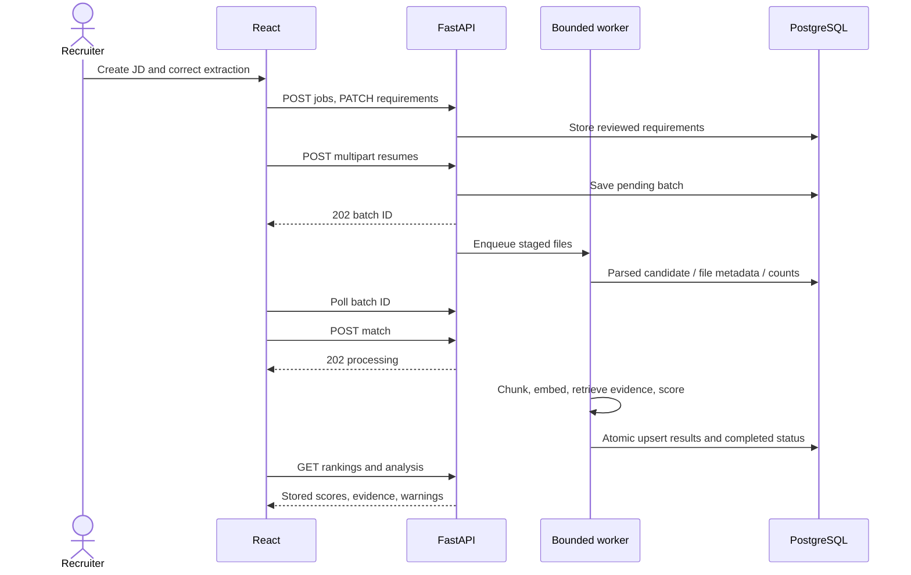

# Architecture

For a complete current walkthrough, see [PROJECT_DOCUMENTATION.md](../PROJECT_DOCUMENTATION.md). The live deployment adds database-backed recruiter sessions and job ownership, public read-only sample jobs, and an ONNX MPNet runtime in the smaller Render image. The normal local image retains the PyTorch runtime. Nine application tables now include `users` and `auth_sessions`; owned jobs and all nested reads/writes enforce visibility rules, while `AUTH_REQUIRED=true` is enabled for hosted writes.

The application is a modular monolith. React manages job context and UI state; Axios is the only HTTP client. FastAPI validates UUIDs, payload sizes, pagination and state conflicts. SQLAlchemy persists jobs, batches, candidates, file metadata and one versioned match per job/candidate pair. Alembic owns schema creation, never a startup `create_all`.

`services/documents.py` validates signature/structure and extracts text. `skills.py` performs longest-phrase matching against a JSON taxonomy. `extraction.py` splits sections and reads job requirements and employment dates. `semantic.py` holds a process-cached Sentence Transformer and tokenizer-bounded evidence matching. `scoring.py` computes deterministic components and explanations independently of HTTP and model loading. `workers.py` owns job execution, per-file transactions and restart recovery.

`jobs` has many `upload_batches`; each batch has candidates; candidates have one `resume_files` record; `match_results` references a job and candidate with a unique current-pair constraint. `matching_runs` records the model and full scoring configuration for every evaluation, while `match_result_history` retains prior score/evidence snapshots before replacement or requirement invalidation. PostgreSQL uses JSONB for extracted lists and evidence. UUID foreign keys and score/index constraints are in the migration. Date fields are timezone-aware; stored employment durations operate at month precision.

Routes use independent database sessions. One ThreadPoolExecutor worker bounds compute; a five-slot semaphore bounds accepted operations. Upload writes are staged in a private directory before scheduling. Matching and uploads for a job cannot overlap through the normal UI/API state checks. These guards are designed for a single local API process; simultaneous requests from multiple processes require transactional locking and a durable queue before deployment. A model lock prevents concurrent initialization or encode calls. One evaluation reuses job embeddings and batches all uncached resume passages in configurable groups (32 by default). A bounded LRU vector cache is isolated by model, revision, input limit, pipeline version, cache directory and loaded model instance. Switching namespaces clears incompatible vectors.

Startup marks unfinished batches failed or partial and interrupted matching failed. It does not resume an incomplete upload manifest automatically. Accepted tasks drain on graceful shutdown. One process is required; multiple workers and reload during tasks are unsupported. Old matching results remain until a new evaluation commits atomically; editing requirements archives and invalidates outdated current results. Adding candidates leaves previous candidates' results until matching is rerun.

Private files use UUID-generated internal names; original names are basename-sanitized metadata. No static route serves uploads. Summary lists omit contacts. Exceptions sent to the UI are generic, and error logging records error types without resume text or contact fields. CORS permits configured localhost origins, and DB queries use ORM expressions. This is not sufficient isolation for untrusted production uploads or real applicant data.
